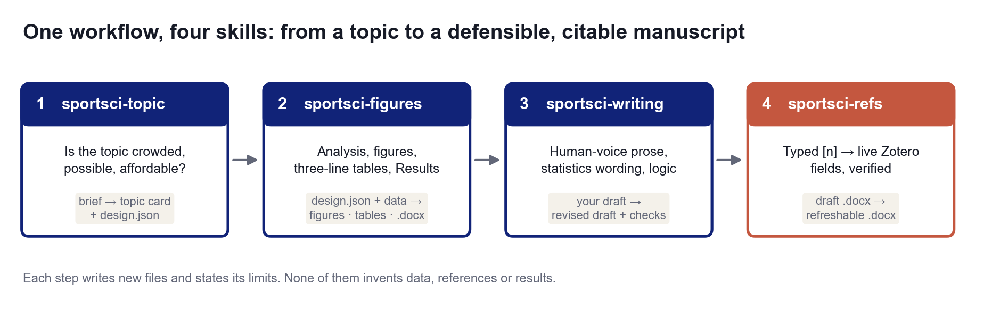

# sportsci-workflow

**One repository for the whole sport-science writing workflow: choose a topic, analyse the data and make the figures, polish the prose, and keep the citations alive in Word.**

[中文说明](README.zh-CN.md)



Four small skills that each do one job, hand files to the next, and can also be used alone. Each is both an
[agent skill](https://docs.claude.com/en/docs/claude-code/skills) (a `SKILL.md` that tells an AI agent how to work) and a command-line tool.

| # | Skill | Question it answers | Main output |
|---|---|---|---|
| 1 | [`sportsci-topic`](skills/sportsci-topic) | Is this topic crowded, possible and affordable? Which design, how many people? | topic card + `design.json` draft |
| 2 | [`sportsci-figures`](skills/sportsci-figures) | What do the data say, and how is it shown? | figures (zh / en), three-line tables, Results `.docx`, methods explained |
| 3 | [`sportsci-writing`](skills/sportsci-writing) | Does the prose read like a person wrote it, and is the logic sound? | revised text, checker report |
| 4 | [`sportsci-refs`](skills/sportsci-refs) | Are the citations real, consistent and still editable? | `.docx` with live Zotero fields, verification report |

## What they have in common

- **No invention.** Data, references, effect sizes and gaps come from files you supply or from computation; when something is missing the tool says so.
- **Rules you can read.** Thresholds and checks are written next to their verdicts (`sportsci-topic`), numbers in text come from the analysis objects (`sportsci-figures`), edits never touch Zotero fields (`sportsci-refs`).
- **Chinese and English.** Figures, tables, cards and guidance exist in both sets; a deliverable never mixes them.
- **New files, not overwrites.** Each command writes a new file and verifies it.

## Install

```bash
git clone https://github.com/gaibin/sportsci-workflow.git
cd sportsci-workflow
python install.py                # pip install -e the three Python packages and copy all four skills to ~/.claude/skills
python install.py --dry-run      # show what it would do
```

Or by hand, one skill at a time:

```bash
pip install -e skills/sportsci-topic -e skills/sportsci-figures -e skills/sportsci-refs
cp -r skills/sportsci-topic skills/sportsci-figures skills/sportsci-writing skills/sportsci-refs ~/.claude/skills/
```

`sportsci-writing` is plain Markdown plus three scripts (`pip install -r skills/sportsci-writing/requirements.txt` for the statistics and plotting helpers).
`sportsci-topic --fetch` uses `sportsci-refs` for literature search when both are installed.

## A pass through the workflow

```bash
# 1  topic: a brief, your exported records, one card
sportsci-topic new -o brief.toml
sportsci-topic card brief.toml -r cnki.csv -r pubmed.ris -o topic_out --lang zh
sportsci-figures check-design topic_out/design_draft.json -d data.csv

# 2  data: analysis, figures, tables, Results document
sportsci-figures results design.json -d data.csv -o results_out -l zh --chapter 4

# 3  writing: polish the draft with the agent; the trace checker flags formulaic patterns
python skills/sportsci-writing/scripts/ai_trace_check.py draft.md

# 4  references: typed [n] -> live Zotero fields, then verify
sportsci-refs fieldify thesis.docx -m zotero_match.json --superscript -o thesis_Zotero.docx
sportsci-refs verify thesis_Zotero.docx -o report.md
```

Details are in each skill's README and `SKILL.md`, and in [`docs/WORKFLOW.md`](docs/WORKFLOW.md): which file passes from one step to the next, and what to check before moving on.

## Colour rule

All figures use one navy palette. The one deliberate exception is the eye-tracking fixation heat map, which uses the rainbow-type `turbo`
map because that is the field's convention; it is a default of that block only and can be overridden with `cmap=`.

## Scope and limits

- The tools check, count, compute and format. They do not decide what is important, and they do not replace a supervisor or an ethics committee.
- `sportsci-writing` does not promise to pass any AI-detection score; it removes formulaic patterns and asks for the specifics only the author has.
- A DOI check shows a paper exists with matching metadata, not that it supports the sentence it is cited for.
- Windows and Word with Zotero 7 are the tested environment for `sportsci-refs`; the document editing itself is plain OOXML.

## Development

Each skill has its own tests and runs offline:

```bash
cd skills/sportsci-topic   && pip install -e ".[dev]" && python -m pytest -q
cd skills/sportsci-figures && pip install -e ".[dev]" && python -m pytest -q
cd skills/sportsci-refs    && pip install -e ".[dev]" && python -m pytest -q
cd skills/sportsci-writing && python -m unittest discover tests
```

## License

MIT, see [LICENSE](LICENSE). Each skill folder carries its own copy.
