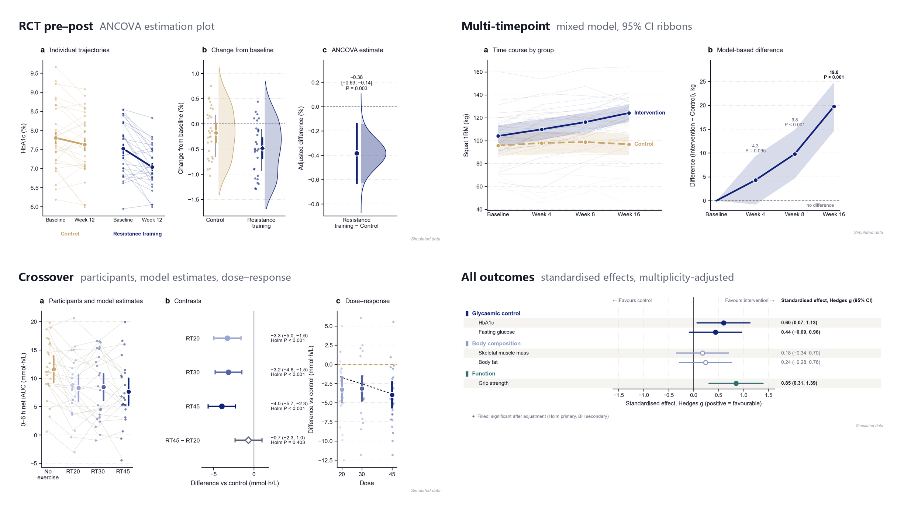
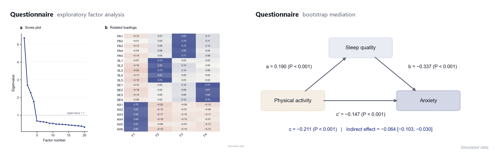
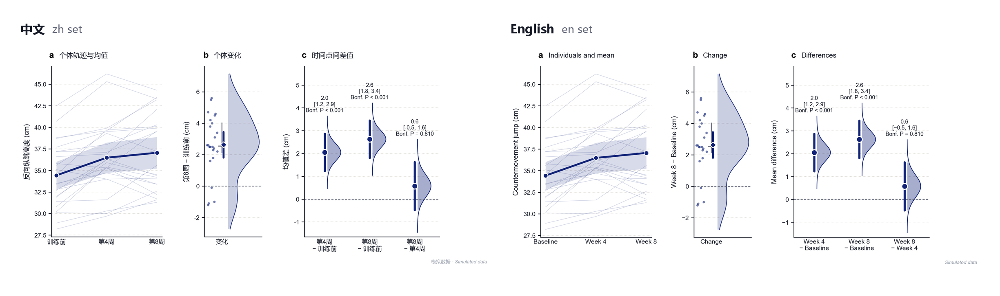
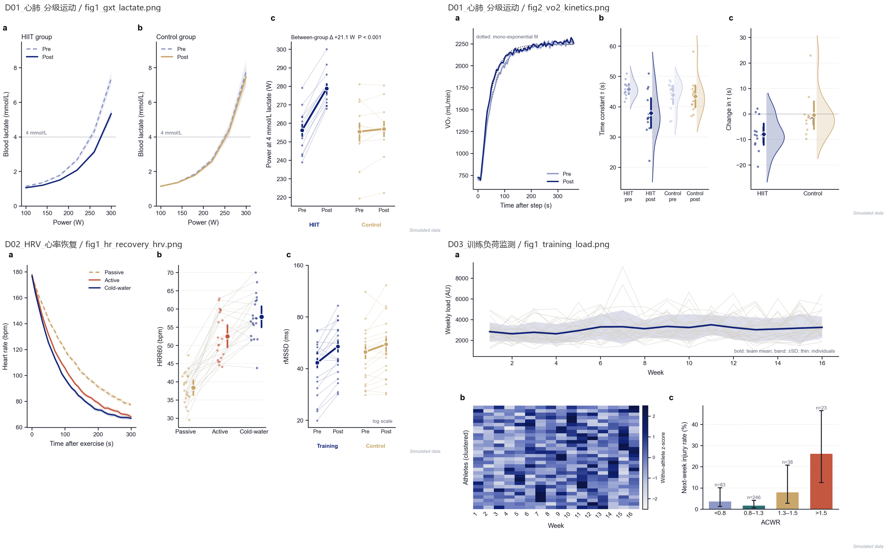

# sportsci-figures

**Publication-grade figures, three-line tables and a ready-to-edit Results section for sport, exercise and health science — from one
design file and your data, in Chinese or English.**

[中文说明](README.zh-CN.md)



- **Six study designs run end to end**: RCT pre–post (ANCOVA), crossover and multi-timepoint (mixed models), single-group repeated
  measures, questionnaire surveys (reliability, EFA, regression, bootstrap mediation, moderation) and meta-analysis.
- **One command → a full Results package**: figures (300-dpi PNG + vector PDF), three-line tables (Word + Excel), the Results text, and a
  methods explanation that justifies every analytic choice with the study's own numbers.
- **26 more data types** as reusable figure blocks: CGM, EMG, force–time, SPM waveforms, GRF, IMU, survival, ROC, omics, GPS tracking …
- **Two language sets, one style**: every label, caption and table in all-Chinese or all-English; layout, colours and statistics identical.
- **Integrity built in**: every number comes from code, wording ("differed" / "did not differ") follows the multiplicity-adjusted P,
  simulated data are stamped on every figure.

## Quick start

```bash
git clone https://github.com/<your-account>/sportsci-figures.git
cd sportsci-figures
pip install -e .

# rehearse with simulated data — no data needed
python cli.py results config/design_templates/parallel_prepost.json --simulate -o demo -l both
```

`demo/en/` and `demo/zh/` now contain `figures/`, `tables.xlsx`, `results.docx`, `results.md` and `methods_explained.md`;
`demo/analysis.json` holds every estimate.

With your own data:

```bash
python cli.py intake my_data.xlsx -o intake         # de-identify, data-quality report, draft design.json
python cli.py new-design -t survey -o design.json   # or start from a template and edit it
python cli.py check-design design.json -d intake/data_clean.csv
python cli.py results design.json -d intake/data_clean.csv -o results -l en
python cli.py results design.json -d intake/data_clean.csv -o thesis -l zh --chapter 4   # degree-thesis numbering (图 4-1)
```

## Designs

| Study | `design` | What you get |
|---|---|---|
| Parallel groups, baseline + follow-up | `parallel_prepost` | ANCOVA with baseline covariate, change scores, Hedges g, estimation plot, baseline table with SMD |
| Every participant in every condition | `crossover` | Random-intercept mixed model, marginal means, Holm-adjusted contrasts, dose–response trend, d_z |
| Parallel groups, ≥ 3 visits | `multitime` | Constrained longitudinal mixed model, CI ribbons, supplementary group × time ANOVA (Greenhouse–Geisser) |
| One group, 2+ visits | `single_group` | Paired t + Wilcoxon or repeated-measures ANOVA (Mauchly, Greenhouse–Geisser, Bonferroni) |
| Questionnaire | `survey` | Cronbach α, KMO/Bartlett, EFA, common-method bias, correlations, group differences, regression, bootstrap mediation, moderation |
| Evidence synthesis | `meta` | Random effects (DerSimonian–Laird + Hartung–Knapp), subgroups, leave-one-out, Egger, meta-regression |

Primary outcomes are Holm-adjusted, secondary outcomes Benjamini–Hochberg within category. Field reference: [`reference/DESIGN_SPEC.md`](reference/DESIGN_SPEC.md).



## Two language sets



Chinese figures use Arial with per-character CJK fallback; English figures are checked for stray Chinese characters before saving.

## Any other data

Pick a figure block by the shape of your data — the style stays the same.

```python
from sportsci_figures.pubstyle import apply_style, save_figure, condition_colors, panel_title, DOUBLE, figures as pf
import matplotlib.pyplot as plt

apply_style("en")                                           # or "zh", before any figure
col = condition_colors(["CON", "RT20", "RT30", "RT45"])     # control sand, doses light → dark navy
fig, ax = plt.subplots(figsize=(DOUBLE, 3.4))
pf.ax_bands(ax, x, {"CON": (mu0, se0), "RT20": (mu1, se1)}, col, dashed=["CON"])
ax.set_xlabel("Time after start (h)"); ax.set_ylabel("Glucose (mmol/L)")
panel_title(ax, "a", "Glucose time course")
save_figure(fig, "out/fig2_timecourse")                     # 300-dpi PNG + vector PDF
```

All 26 data types with runnable examples: [`examples/gallery/`](examples/gallery/) · contact sheets:
[`assets/pubstyle_gallery/`](assets/pubstyle_gallery/) · which block for which data: [`reference/DATA_TYPE_GUIDE.md`](reference/DATA_TYPE_GUIDE.md).



## Use it as an AI agent skill

The repository is also a [Claude Code skill](https://docs.claude.com/en/docs/claude-code/skills): `SKILL.md` tells an agent which path to take,
the house rules, and a self-check list. Clone it into your skills folder:

```bash
git clone https://github.com/<your-account>/sportsci-figures.git ~/.claude/skills/sportsci-figures
pip install -e ~/.claude/skills/sportsci-figures
```

Then ask for "a results figure for my crossover study" or "问卷的信效度和中介分析图表" — the agent follows `SKILL.md`.

## Requirements

Python 3.10+. Chinese figures need a CJK font (Microsoft YaHei, PingFang SC or Noto Sans CJK SC); `has_cjk_font()` tells you whether one was found.

```bash
pip install -e ".[dev]" && python -m pytest -q     # estimates recover simulated truth; results match pingouin / statsmodels
```

## Documentation

| | |
|---|---|
| [`SKILL.md`](SKILL.md) | rules, workflow and self-check (start here) |
| [`docs/STYLE_GUIDE.md`](docs/STYLE_GUIDE.md) | design rationale, palette, finishing rules |
| [`reference/STYLE_SPEC_EN.md`](reference/STYLE_SPEC_EN.md) · [`STYLE_SPEC_ZH.md`](reference/STYLE_SPEC_ZH.md) | normative text for each language set |
| [`reference/DESIGN_SPEC.md`](reference/DESIGN_SPEC.md) · [`GAP_TO_DESIGN.md`](reference/GAP_TO_DESIGN.md) | design file reference; from research question to design |
| [`reference/API.md`](reference/API.md) · [`FIGURE_CATALOG.md`](reference/FIGURE_CATALOG.md) | function signatures; scenario → picture |

## License

MIT — see [LICENSE](LICENSE). Built on matplotlib, statsmodels, scipy, pingouin, pandas and python-docx.
