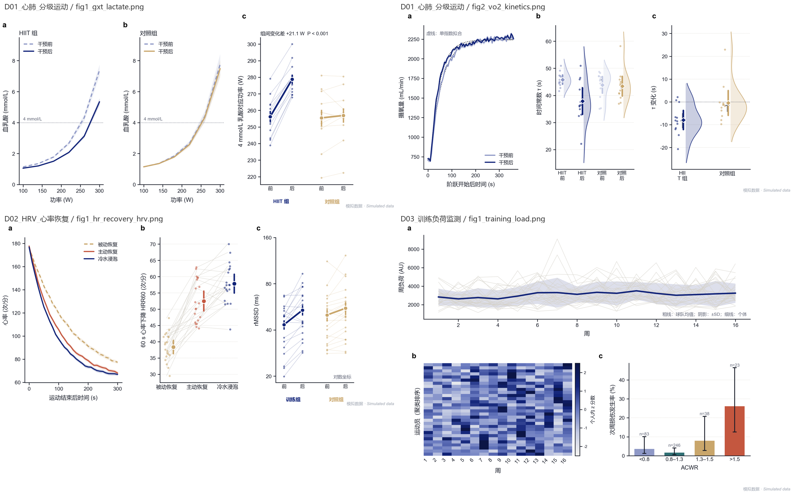

# sportsci-figures

**运动科学、体育与健康研究的出版级图表、三线表和结果章——一个设计文件加上数据，一条命令出齐，中文或英文两套。**

[English](README.md)


- **六种研究设计一键分析**：平行组前后测（ANCOVA）、交叉设计与多时点（混合模型）、单组前后测 / 重复测量、问卷调查（信效度、探索性因子分析、回归、Bootstrap 中介、调节）、Meta 分析。
- **一条命令出完整结果包**：图（300 dpi PNG + 矢量 PDF）、三线表（Word + Excel）、结果段文字，以及用本研究数字解释每个分析选择的"方法讲解与答辩问答"。
- **另有 26 类数据的画图模块**：动态血糖、肌电、力-时曲线、SPM 波形、地面反作用力、IMU、生存分析、ROC、组学、GPS 追踪……
- **中英两套、风格一致**：图内标签、图题表题、表格全中文或全英文；版式、配色、统计完全相同。
- **学术规范内置**：所有数字由代码计算；"差异有/无统计学意义"按多重比较校正后的 P 值自动选词；模拟数据在每张图上都有标记。

## 快速开始

```bash
git clone https://github.com/<your-account>/sportsci-figures.git
cd sportsci-figures
pip install -e .

# 不需要数据，先用模拟数据演练
python cli.py results config/design_templates/parallel_prepost.json --simulate -o demo -l both
```

用自己的数据：

```bash
python cli.py intake 数据.xlsx -o intake              # 去标识化、数据质量报告、研究设计草稿 design.json
python cli.py check-design design.json -d intake/data_clean.csv
python cli.py results design.json -d intake/data_clean.csv -o results -l zh --chapter 4   # 学位论文按章编号：图 4-1、表 4-1
```

`intake` 只是"猜"研究设计、对照组、主要结局和反向计分题，所有"待确认"项都要先核实，再出结果。

## 研究设计

| 研究 | `design` | 输出 |
|---|---|---|
| 平行组前后测 | `parallel_prepost` | 以基线为协变量的 ANCOVA、变化量、Hedges g、估计图、含 SMD 的基线表 |
| 交叉设计 | `crossover` | 随机截距混合模型、边际均值、Holm 校正对比、剂量反应趋势、d_z |
| 平行组多时点 | `multitime` | 约束基线纵向混合模型、CI 阴影带，补充组别 × 时间方差分析（GG 校正） |
| 单组前后测 / 重复测量 | `single_group` | 配对 t + Wilcoxon，或重复测量方差分析（Mauchly、Greenhouse–Geisser、Bonferroni） |
| 问卷调查 | `survey` | Cronbach α、KMO/Bartlett、EFA、共同方法偏差、相关、人口学差异、回归、Bootstrap 中介、调节 |
| Meta 分析 | `meta` | 随机效应（DL + Hartung–Knapp）、亚组、留一法、Egger、Meta 回归 |


## 中英两套


## 其他数据类型

按数据的"形状"选画图模块，风格不变。26 类数据的可运行示例在 [`examples/gallery/`](examples/gallery/)，选图规则见 [`reference/DATA_TYPE_GUIDE.md`](reference/DATA_TYPE_GUIDE.md)，
中文规范全文见 [`reference/STYLE_SPEC_ZH.md`](reference/STYLE_SPEC_ZH.md)。



## 作为 AI 技能使用

仓库本身也是一个 Claude Code skill：`SKILL.md` 告诉 AI 走哪条路径、遵守哪些规则、交付前自查什么。

```bash
git clone https://github.com/<your-account>/sportsci-figures.git ~/.claude/skills/sportsci-figures
pip install -e ~/.claude/skills/sportsci-figures
```

## 运行环境

Python 3.10+。中文图需要中文字体（微软雅黑、苹方或 Noto Sans CJK SC）。测试：`pip install -e ".[dev]" && python -m pytest -q`。

## 许可

MIT，见 [LICENSE](LICENSE)。
