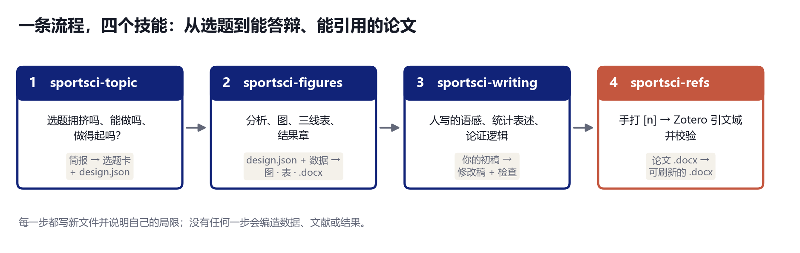

# sportsci-workflow

**一个仓库装下运动科学写作的完整流程：选题、数据分析与出图、润色论证、让 Word 里的引文始终可用。**

[English](README.md)



四个各管一件事的小技能：上一步的产物交给下一步，也可以单独使用。每一个既是
[智能体技能](https://docs.claude.com/en/docs/claude-code/skills)（一份告诉 AI 智能体怎么做的 `SKILL.md`），也是一个命令行工具。

| # | 技能 | 回答的问题 | 主要产出 |
|---|---|---|---|
| 1 | [`sportsci-topic`](skills/sportsci-topic) | 这个题拥挤吗、能做吗、做得起吗？用什么设计、要多少人？ | 选题卡 + `design.json` 草稿 |
| 2 | [`sportsci-figures`](skills/sportsci-figures) | 数据说了什么，怎么呈现？ | 图（中 / 英）、三线表、结果章 `.docx`、方法讲解 |
| 3 | [`sportsci-writing`](skills/sportsci-writing) | 文字像不像人写的，论证是否站得住？ | 修改稿、检查报告 |
| 4 | [`sportsci-refs`](skills/sportsci-refs) | 引文是否真实、一致、仍可编辑？ | 带 Zotero 引文域的 `.docx`、校验报告 |

## 它们的共同点

- **不编造。** 数据、文献、效应量和研究缺口只来自你提供的文件或计算；缺什么，工具就说缺什么。
- **规则看得见。** 阈值和检查写在结论旁边（`sportsci-topic`），正文里的数字来自分析对象（`sportsci-figures`），改稿不碰 Zotero 引文域（`sportsci-refs`）。
- **中英文都有。** 图、表、卡片和说明各有两套，一份交付物不会混用。
- **写新文件，不覆盖。** 每条命令都写新文件并校验。

## 安装

```bash
git clone https://github.com/gaibin/sportsci-workflow.git
cd sportsci-workflow
python install.py                # 以可编辑方式安装三个 Python 包，并把四个技能复制到 ~/.claude/skills
python install.py --dry-run      # 只显示会做什么
```

也可以手动、一个一个来：

```bash
pip install -e skills/sportsci-topic -e skills/sportsci-figures -e skills/sportsci-refs
cp -r skills/sportsci-topic skills/sportsci-figures skills/sportsci-writing skills/sportsci-refs ~/.claude/skills/
```

`sportsci-writing` 是 Markdown 加三个脚本（统计和绘图辅助需要 `pip install -r skills/sportsci-writing/requirements.txt`）。
两者都装时，`sportsci-topic --fetch` 会借用 `sportsci-refs` 联网检索文献。

## 走一遍流程

```bash
# 1  选题：简报 + 导出的题录 → 一张卡
sportsci-topic new -o brief.toml
sportsci-topic card brief.toml -r cnki.csv -r pubmed.ris -o topic_out --lang zh
sportsci-figures check-design topic_out/design_draft.json -d data.csv

# 2  数据：分析、图、表、结果章
sportsci-figures results design.json -d data.csv -o results_out -l zh --chapter 4

# 3  写作：和智能体一起润色初稿；检查脚本标出套路化的句式
python skills/sportsci-writing/scripts/ai_trace_check.py draft.md

# 4  参考文献：手打 [n] → Zotero 引文域，然后校验
sportsci-refs fieldify thesis.docx -m zotero_match.json --superscript -o thesis_Zotero.docx
sportsci-refs verify thesis_Zotero.docx -o report.md
```

细节见各技能自己的 README 和 `SKILL.md`，以及 [`docs/WORKFLOW.md`](docs/WORKFLOW.md)：每一步传给下一步的是哪个文件，进入下一步前该检查什么。

## 配色规则

所有图只用一套海军蓝配色。唯一有意的例外是眼动注视热力图，它用彩虹类的 `turbo`，因为这是眼动领域的标准画法；这只是该图块的默认值，可用 `cmap=` 覆盖。

## 适用范围与限制

- 这些工具负责检查、计数、计算和排版；它们不决定什么重要，也不替代导师或伦理委员会。
- `sportsci-writing` 不承诺通过任何 AI 检测分数；它去掉套路化的表达，并要求补上只有作者才有的具体信息。
- DOI 核验只说明文献存在且元数据一致，不说明它支持被引用的那句话。
- `sportsci-refs` 的测试环境是 Windows + Word + Zotero 7；文档编辑本身是纯 OOXML 操作。

## 开发

每个技能有自己的测试，离线运行：

```bash
cd skills/sportsci-topic   && pip install -e ".[dev]" && python -m pytest -q
cd skills/sportsci-figures && pip install -e ".[dev]" && python -m pytest -q
cd skills/sportsci-refs    && pip install -e ".[dev]" && python -m pytest -q
cd skills/sportsci-writing && python -m unittest discover tests
```

## 许可

MIT，见 [LICENSE](LICENSE)。每个技能文件夹里也有一份。
