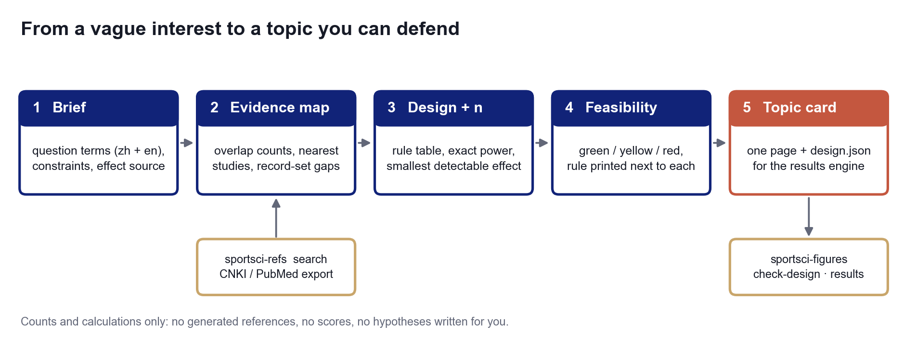

# sportsci-topic

**Choose a sport-science topic with evidence, a design, a sample size and a feasibility check — every number computed, every rule printed.**

[中文说明](README.zh-CN.md)



"Is this topic doable?" is usually answered by feel. `sportsci-topic` answers it with four questions that can be counted:

1. **Is it crowded?** — your own record set (CNKI / PubMed / Zotero exports) is matched against the population, intervention and outcome of the question; you get overlap counts, the nearest studies, and statements such as *"14 records cover this population and intervention, none measures this outcome"*.
2. **Which design answers it, and what may you claim?** — an explicit rule table, not a suggestion.
3. **Are there enough people?** — exact power at the number you can really recruit, and the *smallest effect that number can detect*.
4. **Do you have the weeks, the instruments, the ethics route and the statistics?** — green / yellow / red, with the rule printed next to each.

The result is a one-page **topic card** (Chinese or English) and a `design.json` draft that [`sportsci-figures`](../sportsci-figures) can validate and analyse.

What it deliberately does not do: invent references, score hypotheses with a model, write a research gap for you, or add up a "quality score".
A gap is only ever stated about *your record set*, with the counts it rests on.

## Quick start

```bash
git clone https://github.com/gaibin/sportsci-workflow.git
cd sportsci-workflow/skills/sportsci-topic
pip install -e .

sportsci-topic new -o brief.toml        # a commented form: question terms (zh + en), outcomes, constraints, effect source
sportsci-topic check brief.toml         # errors, warnings, the design it maps to, the queries it would run
sportsci-topic card brief.toml -r cnki.csv -r pubmed.ris -o topic_out --lang en
#   topic_out/topic_card.md      the card
#   topic_out/design_draft.json  -> sportsci-figures check-design
#   topic_out/topic_data.json    every number on the card
```

Try it without any data of your own: `python cli.py card examples/demo_brief.toml -r examples/demo_records.csv -o demo --this-year 2025`
(the demo records are synthetic and labelled as such).

### What the card looks like

```
🔴 red items: change the topic or the constraints first
 🔴 Sample size   d = 0.70: needs 68 analysed (80 enrolled with dropout); 40 accessible, about 34 analysed, power 0.51;
                  that n detects d ≈ 0.99 at 80% power.
 🟢 Time          needs 22 weeks (ethics 4 + recruitment 2 + intervention 8 + testing 2 + analysis/writing 6); 28 available; slack 6.
 🟡 Ethics        ethics pending: no recruitment or data collection before approval
 🟢 Overlap       30 records; direct overlap in the last 5 years: 1 (2 in all years).
```

The red row is the useful one: with 40 people the study can only detect an effect of about d = 1.0. The options are a stronger
or longer intervention, a within-subject design, a more responsive outcome, or more people — the card lists them, you decide.

## Commands

| Command | Does |
|---|---|
| `new` | writes a commented `brief.toml` (refuses to overwrite) |
| `check` | validates the brief and shows the design and search queries |
| `evidence` | overlap counts by P / I / O combination, nearest studies, record-set statements |
| `variants` | changes one axis at a time (population, intervention, comparator, outcome) and recounts |
| `power` | `two-sample`, `paired`, `ancova`, `correlation`, `anova`, `regression`: required n, or power and smallest detectable effect for a given n |
| `card` | all of the above → card, design draft, data file; `--fetch` searches through `sportsci-refs` when it is installed |

```bash
sportsci-topic power two-sample -e 0.5 --dropout 0.15      # d = 0.500: n1 = 64 ... enrol 76 per arm
sportsci-topic power two-sample --n 17                     # n = 17 per group: smallest detectable d = 0.99
sportsci-topic power ancova --delta 3 --sd 5 --r-prepost 0.6
```

```python
from sportsci_topic.pipeline import run
r = run("brief.toml", ["cnki.csv"], lang="en")
r.assessment["overall"], r.evidence.direct_recent, r.plan.mdes_at_accessible
```

## Records

Export from CNKI / Wanfang / Web of Science / PubMed / Zotero. Accepted: `.csv` (UTF-8 or GBK; headers such as `Title-题名`, `Year-年`, `Summary-摘要` are recognised),
`.ris`, `.json` (CSL-JSON or a list of `{title, year, …}`) and `.txt` (one title or one GB/T 7714 entry per line).
With [`sportsci-refs`](../sportsci-refs) installed, `--fetch` runs pairwise queries (P+I, I+O, P+O, P+I+O) in both languages.

## Why it is built this way

| Common failure | Consequence | What this does |
|---|---|---|
| Canned "consensus and controversies" text | the same paragraph for every topic; looks like a literature review, is not | no text about the literature is generated — only counts |
| Ranking ideas by word overlap with the input | numbers that look precise and mean nothing | no score; each check has its own rule and colour |
| Sample size from a template or a rule of "30 per group" | the study cannot detect the effect it was designed for | exact power; reports the smallest detectable effect at the n you can recruit |
| An empty search result read as "nobody has done this" | a crowded topic is chosen | a variant with no matching record is "not assessable"; fewer than 30 records is flagged as a sketch |
| Effect size picked to make n small | an unfundable, unpublishable plan | the effect size must name its source or the sample size is marked illustrative |
| The same suggested topic for every student | duplicate theses | variants are counted against the student's own records, one axis at a time |

Every threshold and rule: [`reference/METHOD.md`](reference/METHOD.md). Every brief field: [`reference/BRIEF_FIELDS.md`](reference/BRIEF_FIELDS.md).

## Use it as an AI agent skill

`SKILL.md` splits the work: the agent builds the bilingual search vocabulary, proposes variants and explains the card; the code counts and calculates.

```bash
git clone https://github.com/gaibin/sportsci-workflow.git
cp -r sportsci-workflow/skills/sportsci-topic ~/.claude/skills/
pip install -e ~/.claude/skills/sportsci-topic
```

## Scope and limits

- It says whether a topic is crowded, possible and affordable. It cannot say whether it is important or interesting.
- It does not read papers: a record that mentions all three facets may still study something else. Read the nearest studies.
- CNKI cannot be searched automatically; export the records.
- Multi-time-point mixed models have no closed-form power; ANCOVA at the final time point is used and labelled.
- Survey sample sizes are rules of thumb unless you supply `r` or `f²`.

Part of [sportsci-workflow](../../README.md): **sportsci-topic** (this module) → **sportsci-figures** → **sportsci-writing** → **sportsci-refs**.

## Development

```bash
pip install -e ".[dev]"
python -m pytest -q          # offline
```

## License

MIT — see [LICENSE](LICENSE).
