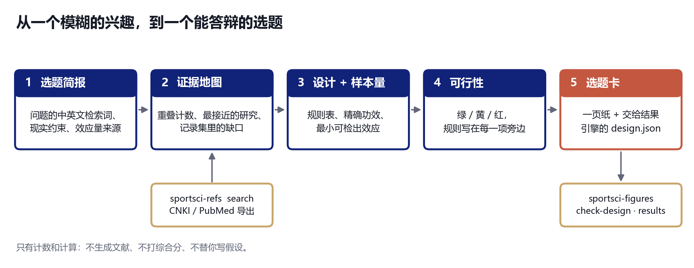

# sportsci-topic

**用证据、设计、样本量和可行性检查来选运动科学的题——每个数字都是算出来的，每条规则都摆在明面上。**

[English](README.md)



"这个题能不能做？"通常靠感觉回答。`sportsci-topic` 把它拆成四个可以数出来的问题：

1. **撞题吗？** 把你自己导出的题录（CNKI / PubMed / Zotero）按问题里的人群、干预、结局去匹配，得到重叠计数、最接近的研究，
   以及这样的陈述：*"记录集中有 14 条同时涉及该人群与干预，没有一条测了这个结局"*。
2. **用什么设计，能下什么结论？** 一张明确的规则表，而不是"建议"。
3. **人够不够？** 按你实际能招到的人数算精确功效，并给出**这个人数能检出的最小效应**。
4. **周数、设备、伦理流程、统计基础够不够？** 绿 / 黄 / 红，规则就印在每一项旁边。

产出是一页**选题卡**（中文或英文）和一份 [`sportsci-figures`](../sportsci-figures) 能直接校验和分析的 `design.json` 草稿。

它有意**不做**的事：编造文献、用模型给假设打分、替你写研究缺口、把各项加成一个"质量分"。
缺口只会被陈述为"你这份记录集里的事实"，并带上它依据的计数。

## 快速开始

```bash
git clone https://github.com/gaibin/sportsci-workflow.git
cd sportsci-workflow/skills/sportsci-topic
pip install -e .

sportsci-topic new -o brief.toml        # 带注释的表单：问题的中英文检索词、测量指标、现实约束、效应量来源
sportsci-topic check brief.toml         # 报错、警告、对应的设计、将要用的检索式
sportsci-topic card brief.toml -r cnki.csv -r pubmed.ris -o topic_out --lang zh
#   topic_out/topic_card.md      选题卡
#   topic_out/design_draft.json  -> sportsci-figures check-design
#   topic_out/topic_data.json    卡片上每个数字的来源
```

没有自己的数据也能试：`python cli.py card examples/demo_brief.toml -r examples/demo_records.csv -o demo --this-year 2025`
（示例题录是合成的，并且都标注了"synthetic example"）。

### 卡片长什么样

```
🔴 有红色项：调整选题或条件后再继续
 🔴 样本量  d = 0.70：需要分析 68 人（含脱落约入组 80）；可及 40 人，脱落后约 34，功效 0.51；
            该人数能以 80% 功效检出的最小效应 d ≈ 0.99。
 🟢 时间    需要 22 周（伦理 4 + 招募 2 + 干预 8 + 测试 2 + 分析写作 6），可用 28 周，余量 6 周。
 🟡 伦理    伦理审批中：批准前不能招募或收集数据
 🟢 撞题    30 条记录；近 5 年直接重叠 1 条（全部年份 2 条）。
```

红色这一行最有用：40 个人只能检出约 d = 1.0 的效应。出路是更强或更长的干预、受试者自身对照的设计、更敏感的指标，
或者更多的人——卡片把选项列出来，由你决定。

## 命令

| 命令 | 作用 |
|---|---|
| `new` | 生成带注释的 `brief.toml`（不覆盖已有文件） |
| `check` | 校验简报，显示对应设计与检索式 |
| `evidence` | 按 P / I / O 组合统计重叠，列出最接近的研究和记录集陈述 |
| `variants` | 每次改一个轴（人群、干预、对照、结局）并重新统计 |
| `power` | `two-sample`、`paired`、`ancova`、`correlation`、`anova`、`regression`：算所需人数，或给定人数时算功效与最小可检出效应 |
| `card` | 以上全部 → 选题卡、设计草稿、数据文件；装了 `sportsci-refs` 时可用 `--fetch` 联网检索 |

```bash
sportsci-topic power two-sample -e 0.5 --dropout 0.15      # d = 0.500：每组 64，含脱落入组 76
sportsci-topic power two-sample --n 17                     # 每组 17 人：最小可检出 d = 0.99
sportsci-topic power ancova --delta 3 --sd 5 --r-prepost 0.6
```

```python
from sportsci_topic.pipeline import run
r = run("brief.toml", ["cnki.csv"], lang="zh")
r.assessment["overall"], r.evidence.direct_recent, r.plan.mdes_at_accessible
```

## 题录

从 CNKI / 万方 / Web of Science / PubMed / Zotero 导出。支持 `.csv`（UTF-8 或 GBK；能识别 `Title-题名`、`Year-年`、`Summary-摘要` 这类表头）、
`.ris`、`.json`（CSL-JSON 或 `{title, year, …}` 列表）和 `.txt`（每行一个题名或一条 GB/T 7714 文献）。
装了 [`sportsci-refs`](../sportsci-refs) 后，`--fetch` 会用两两组合（P+I、I+O、P+O、P+I+O）的中英文检索式去查。

## 为什么这样做

| 常见错误 | 后果 | 本工具的做法 |
|---|---|---|
| 写死的"研究共识与争议" | 任何题目都是同一段话，像文献综述但不是 | 不生成任何关于文献的文字，只给计数 |
| 用与输入的词重合度给想法排名 | 数字看起来精确，其实没有信息 | 没有综合分；每项有自己的规则和颜色 |
| 样本量照搬模板或"每组 30 人" | 研究检不出它设计时想检的效应 | 精确功效；给出你能招到的人数下的最小可检出效应 |
| 把"没检索到"当成"没人做过" | 选了一个很拥挤的题 | 变体的检索词在记录集里一条都没有，就标"不可判断"；不足 30 条标为草图 |
| 为了让 n 小而挑效应量 | 做不下去也发不出去的方案 | 效应量必须写来源，否则样本量只作示意 |
| 同一个建议选题给所有学生 | 论文撞题 | 变体在你自己的记录集里逐轴统计 |

所有阈值与规则：[`reference/METHOD.md`](reference/METHOD.md)；简报每个字段：[`reference/BRIEF_FIELDS.md`](reference/BRIEF_FIELDS.md)。

## 作为 AI 技能使用

`SKILL.md` 把工作分开：智能体负责整理中英文检索词、提出变体并解读卡片；计数和计算都交给代码。

```bash
git clone https://github.com/gaibin/sportsci-workflow.git
cp -r sportsci-workflow/skills/sportsci-topic ~/.claude/skills/
pip install -e ~/.claude/skills/sportsci-topic
```

## 适用范围与限制

- 它说明一个题是否拥挤、能否做成、做不做得起；它不能说明题目是否重要、有没有意思。
- 它不读论文：摘要里同时出现三个要素的记录，研究的可能是别的东西。要读最接近的研究。
- CNKI 不能自动检索，请自己导出题录。
- 多时间点混合模型没有闭式功效公式，这里用终测时点的 ANCOVA 并标注。
- 问卷研究的样本量是经验规则，除非你提供 `r` 或 `f²`。

这是 [sportsci-workflow](../../README.zh-CN.md) 的一部分：**sportsci-topic**（选题，本模块）→ **sportsci-figures** → **sportsci-writing** → **sportsci-refs**。

## 开发

```bash
pip install -e ".[dev]"
python -m pytest -q          # 离线
```

## 许可

MIT，见 [LICENSE](LICENSE)。
